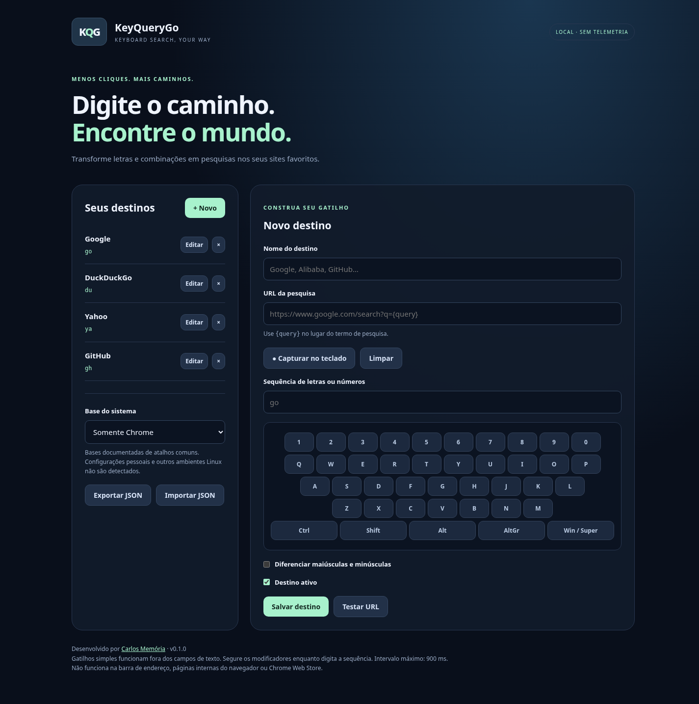

# KeyQueryGo

Search any site with custom keyboard triggers.

By **Carlos Memória** · [memoria.pro](https://memoria.pro).
Initial Chrome release. Firefox adaptation and Chrome Web Store submission are planned.

## Install

Download and extract the release ZIP. Open `chrome://extensions`, enable Developer mode,
click **Load unpacked** and select the folder containing manifest.json.
Open extension settings and reload existing web tabs.
Outside text fields, type `go` (Google), `du` (DuckDuckGo), or `ya` (Yahoo).
Enter your search and press Enter. Esc closes the overlay.

## Configure

Add destinations with HTTP(S) URL templates containing `{query}`.
Capture physical keys or use the visual keyboard. Enable case sensitivity if desired.
Modifiers: Ctrl, Shift, Alt, AltGr, Windows/Super.
Hold modifiers while typing each sequence step; interval maximum 900 ms.
Export/import destinations as JSON. Test a URL before saving.

## Conflicts and limitations

Each letter is checked against documented Chrome and selected OS defaults.
Prefix collisions between configured destinations are rejected.
Bases cover common shortcuts, not all shortcuts or custom mappings.
GNOME has its own base; other Linux desktops are not covered.
Reserved shortcuts can be intercepted before the extension receives them.
Plain triggers are ignored in editable fields. Modified sequences can work there,
but their initial letters may trigger editing actions before completion.
AltGr depends on keyboard layout. Function keys are not supported.
Content scripts run on ordinary HTTP(S) pages, not the address bar, Chrome internal pages,
Chrome Web Store or other protected pages. Firefox and macOS are not verified.

## Privacy

No analytics, ads, accounts or keyboard logs. Settings are stored locally.
Keyboard events are processed transiently in memory. Only submitted queries go to
the chosen provider. See [PRIVACY.md](PRIVACY.md).
The storage permission saves settings. HTTP(S) content-script matches enable trigger recognition.

## Development

No runtime dependencies or build step.

- `npm test`: matching and conflict tests.
- `npm run check`: syntax and manifest checks.
- `npm run package`: upload ZIP in dist/.

## Sources

[Chrome](https://support.google.com/chrome/answer/157179?hl=en) ·
[Windows](https://support.microsoft.com/en-us/accessibility/windows/keyboard-shortcuts-in-windows) ·
[GNOME](https://help.gnome.org/gnome-help/shell-keyboard-shortcuts.html).

## License

MIT.

GitHub Actions template: `docs/check-workflow.yml`. To enable CI, move it to `.github/workflows/check.yml` using an account credential with workflow permission.
